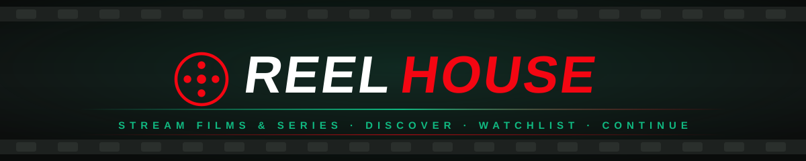
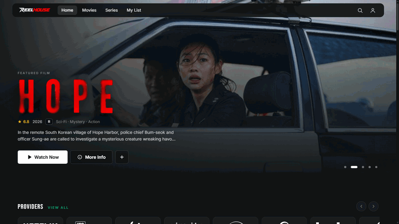
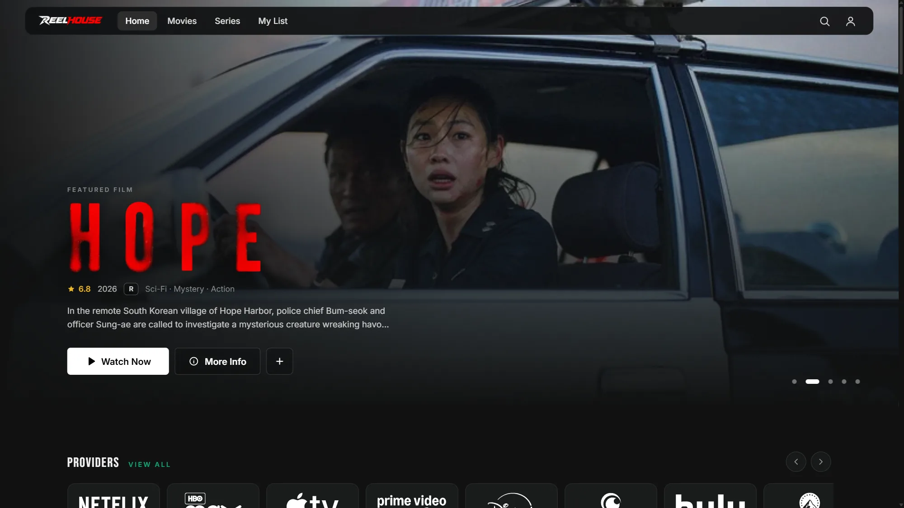
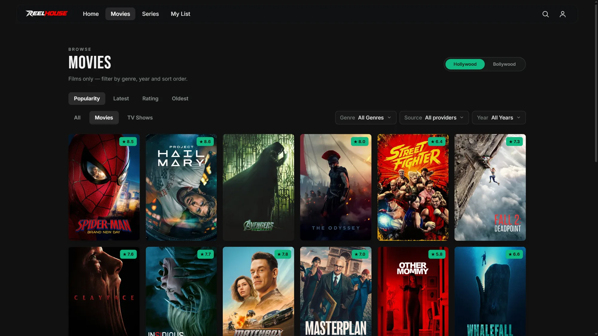
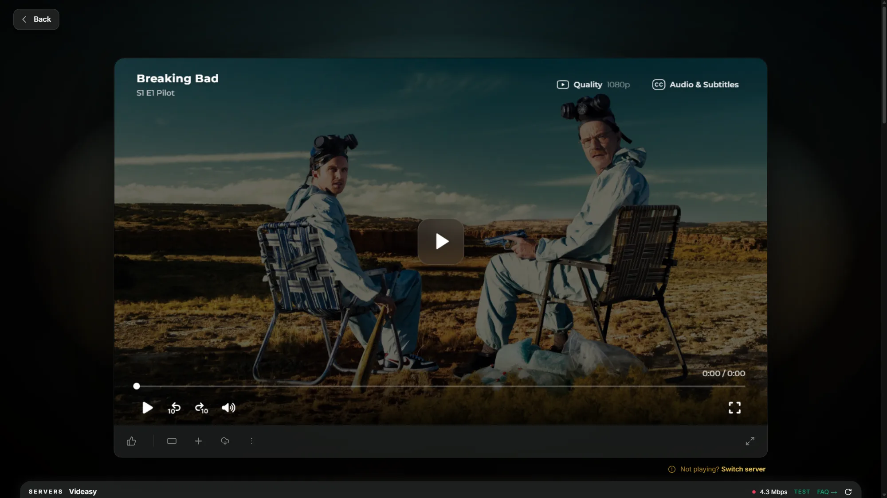
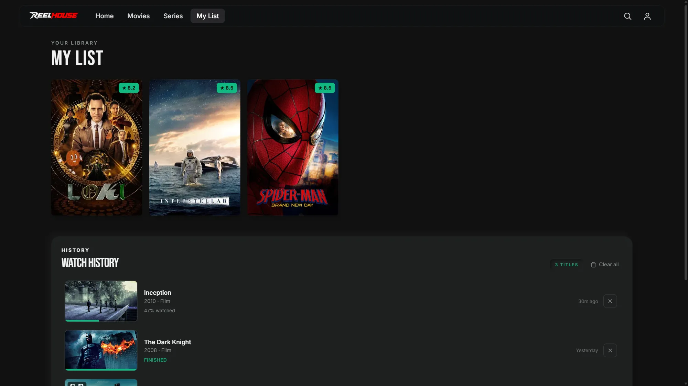
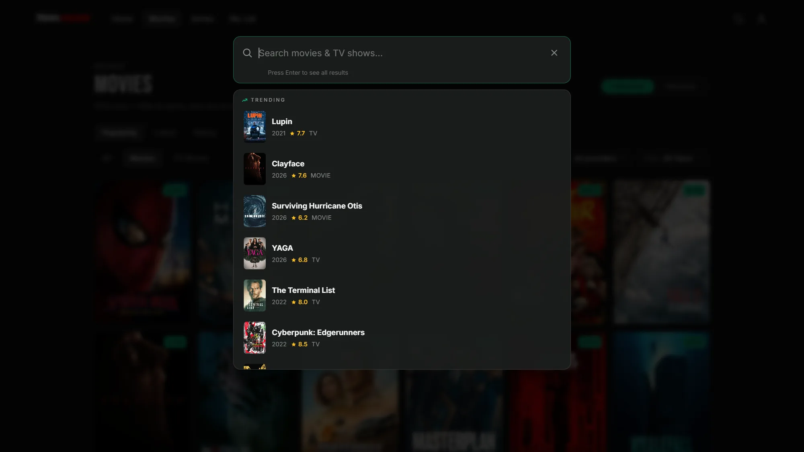
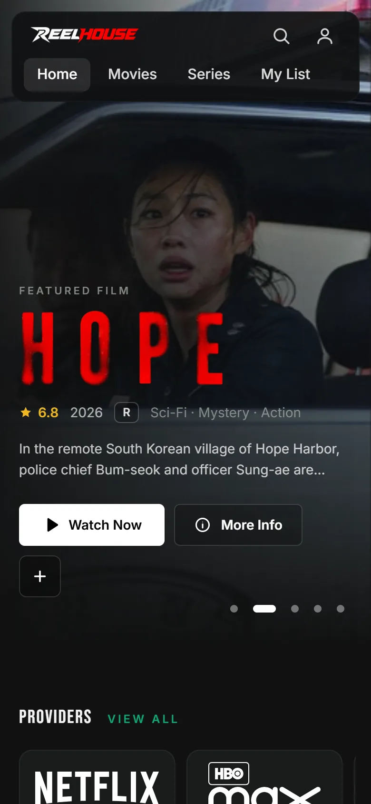
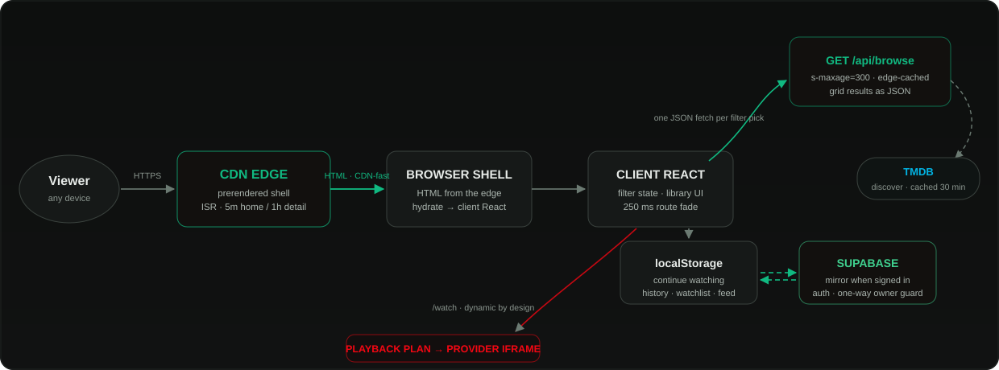
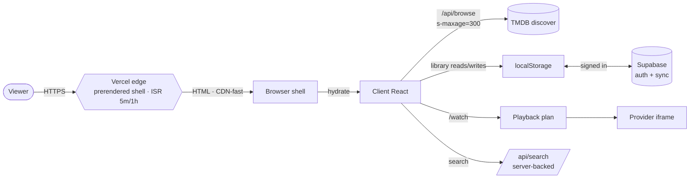

<div align="center">



<br/>


<br/>


<br/>


<br/><br/>

<table>
<tr>
<td align="center" width="150"><a href="#-see-it-running"><b>👀 See it</b></a></td>
<td align="center" width="150"><a href="#-how-it-works"><b>🧩 Pipeline</b></a></td>
<td align="center" width="150"><a href="#-whats-in-the-box"><b>✨ Features</b></a></td>
<td align="center" width="150"><a href="#-measured-not-claimed"><b>📈 Numbers</b></a></td>
<td align="center" width="150"><a href="#-quick-start"><b>⚡ Quick start</b></a></td>
<td align="center" width="150"><a href="#-docs"><b>📖 Docs</b></a></td>
</tr>
</table>

<sub><b>Reelhouse</b> is a streaming front end — discover films and series, pick a server, and continue exactly where you left off. Pages are prerendered and served from the CDN edge; your library lives in the browser and syncs to Supabase when you sign in.</sub>

<br/>


</div>

<div align="center">

## 👀 See it running

</div>



<table>
<tr>
<td width="50%"></td>
<td width="50%"></td>
</tr>
<tr>
<td align="center"><b>🏠 Home</b><br/><sub>Hero · continue watching · providers · My Feed</sub></td>
<td align="center"><b>🎞 Movies &amp; Series</b><br/><sub>Static shell · client-side filters · CDN-fast</sub></td>
</tr>
<tr>
<td width="50%"></td>
<td width="50%"></td>
</tr>
<tr>
<td align="center"><b>▶ Watch page</b><br/><sub>Server chips · Mbps test · episodes rail</sub></td>
<td align="center"><b>🔖 My List</b><br/><sub>Watchlist + one-row-per-title history</sub></td>
</tr>
<tr>
<td width="50%"></td>
<td width="50%"></td>
</tr>
<tr>
<td align="center"><b>🔎 Search</b><br/><sub>Recent chips · trending seed · full results page</sub></td>
<td align="center"><b>📱 Mobile</b><br/><sub>Same design system, tuned breakpoints</sub></td>
</tr>
</table>

<sub>⚠️ Captures come from a production build running live TMDB metadata. TMDB artwork remains subject to TMDB's terms — attribution at the bottom of this page.</sub>

<br/>

<div align="center">

</div>

<div align="center">

## 🧩 How it works

</div>



<details>
<summary><b>🔬 Same topology as a Mermaid graph</b> (click to expand)</summary>



</details>

<br/>

<table>
<tr><th align="left" width="150">Stage</th><th align="left">What happens</th><th align="left" width="260">Guarantee</th></tr>
<tr><td><b>1 · Edge</b></td><td>Pages are prerendered (ISR: home 5 min, detail 1 h) and served from the CDN — no cookies in the render path, auth resolves client-side</td><td>Shell arrives without a server round-trip</td></tr>
<tr><td><b>2 · Data</b></td><td>One small JSON fetch per filter pick from <code>/api/browse</code>; TMDB responses cached 30 min server-side</td><td>Popular filter combos come from the edge</td></tr>
<tr><td><b>3 · Personal</b></td><td>Library (continue watching, history, watchlist) lives in <code>localStorage</code>; Supabase mirrors it when signed in</td><td>Anonymous browsing is instant, sign-in never blanks the page</td></tr>
<tr><td><b>4 · Playback</b></td><td><code>/watch</code> resolves a provider plan → embeds the provider's player; progress is recorded per title/episode regardless of provider</td><td>Provider-independent history</td></tr>
</table>

<br/>

<div align="center">

</div>

<div align="center">

## ✨ What's in the box

</div>

<table>
<tr>
<td width="33%" valign="top"><b>⚡ CDN-first rendering</b><br/><sub>Prerendered shells + ISR, edge-cached browse API, client-side auth — no cookie in the render path, so nothing pays a server round-trip on the hot path.</sub></td>
<td width="33%" valign="top"><b>⏯ Continue watching, done right</b><br/><sub>One card per title, newest episode wins; progress per episode survives; provider-independent — even embeds that report nothing get a record.</sub></td>
<td width="33%" valign="top"><b>🧠 My Feed</b><br/><sub>Curated all-time pools (movies <i>and</i> series) with watch-history genres steering the pick, rotating daily. Renders with zero history.</sub></td>
</tr>
<tr>
<td valign="top"><b>📺 Providers, deduped</b><br/><sub>Family collapse (Netflix Kids → Netflix, flagship reseller resolution) in the rail, the Source filter and provider pages — one entry per brand, priority ordered.</sub></td>
<td valign="top"><b>🎬 A real watch page</b><br/><sub>Server chips with live Mbps test, switch-server border beam, episode rail with per-episode progress, vidvault downloads, keyboard + fullscreen.</sub></td>
<td valign="top"><b>🔎 Search that respects you</b><br/><sub>Debounced, server-backed, recent-search chips you can clear, trending seed when idle — and zero spinners between routes (250 ms fade).</sub></td>
</tr>
<tr>
<td valign="top"><b>🫥 Zero-config offline mode</b><br/><sub><code>npm install && npm run dev</code> boots the entire product — playback included — against a bundled catalog, with a banner saying so. No keys, no database.</sub></td>
<td valign="top"><b>🔐 Auth without the tax</b><br/><sub>Supabase email + OAuth, anonymous-local migration on sign-in, and a one-way owner guard so a shared browser never leaks your list into someone else's account.</sub></td>
<td valign="top"><b>🧪 Quality gates</b><br/><sub>193 Vitest tests across 14 files, full <code>tsc</code>, production build — and every performance number on this page was measured with browser tooling, not estimated.</sub></td>
</tr>
</table>

<br/>

<div align="center">

</div>

<div align="center">

## 📈 Measured, not claimed

</div>

<table>
<tr><th align="left">Metric</th><th align="left" width="140">Result</th><th align="left">How</th></tr>
<tr><td>Home TTFB (production build)</td><td><b>12 ms</b></td><td>Prerendered ISR page served from cache — the reference site measures 25 ms</td></tr>
<tr><td>Browse shell / filter fetch</td><td><b>83 ms / 7 ms</b></td><td>Static page + <code>/api/browse</code> edge-cached per filter combination</td></tr>
<tr><td>Home HTML payload</td><td><b>473 KB</b></td><td>12 rows · 210 cards after stripping per-card text fields (was 537 KB)</td></tr>
<tr><td>Card poster weight</td><td><b>−48%</b></td><td>w342 instead of w500 — 57 KB vs 112 KB per poster, measured on the same artwork</td></tr>
<tr><td>Route transitions</td><td><b>0 spinners</b></td><td>Root loading state removed; 250 ms crossfade, previous page held in place</td></tr>
<tr><td>Quality gates</td><td><b>193/193</b></td><td>Vitest + <code>tsc --noEmit</code> + production build on every change</td></tr>
</table>

<br/>

<div align="center">

</div>

<div align="center">

## ⚡ Quick start

</div>

```bash
npm install
npm run dev
```

Open **http://localhost:3000** — the entire product works offline, playback included. No `.env`, no keys, no database.

<details>
<summary><b>🔑 Optional integrations</b> (live TMDB metadata, accounts, subtitles)</summary>

<br/>

```bash
cp .env.local.example .env.local
```

```dotenv
# Live metadata — v3 API key or v4 read-access token, detected automatically
TMDB_API_KEY=

# Accounts, watchlist sync and playback history
NEXT_PUBLIC_SUPABASE_URL=
NEXT_PUBLIC_SUPABASE_ANON_KEY=

# Subtitle search (server-side only)
OPENSUBTITLES_API_KEY=
# ...plus these two to also *download* a selected subtitle
OPENSUBTITLES_USERNAME=
OPENSUBTITLES_PASSWORD=
```

Each block is independent — add only what you need. Apply `supabase/migrations/0001_init.sql` for the schema + RLS. Behind a proxy/CDN, set `SITE_URL` (see [`docs/deployment.md`](docs/deployment.md)). For video providers, see [`docs/video-provider-setup.md`](docs/video-provider-setup.md).

</details>

<br/>

<div align="center">

</div>

<div align="center">

## 📚 Docs

<table>
<tr>
<td align="center" width="170"><a href="PROGRESS.md"><b>PROGRESS.md</b></a><br/><sub>the project's source of truth</sub></td>
<td align="center" width="170"><a href="docs/video-provider-setup.md"><b>video-provider-setup</b></a><br/><sub>five slots, operator decision</sub></td>
<td align="center" width="170"><a href="docs/deployment.md"><b>deployment</b></a><br/><sub>Vercel / proxy / SITE_URL</sub></td>
<td align="center" width="170"><a href="docs/phase-2.md"><b>phase-2.md</b></a><br/><sub>supabase + sync design</sub></td>
</tr>
</table>

<br/>

<sub>This product uses the TMDB API but is not endorsed or certified by TMDB.</sub>


</div>
